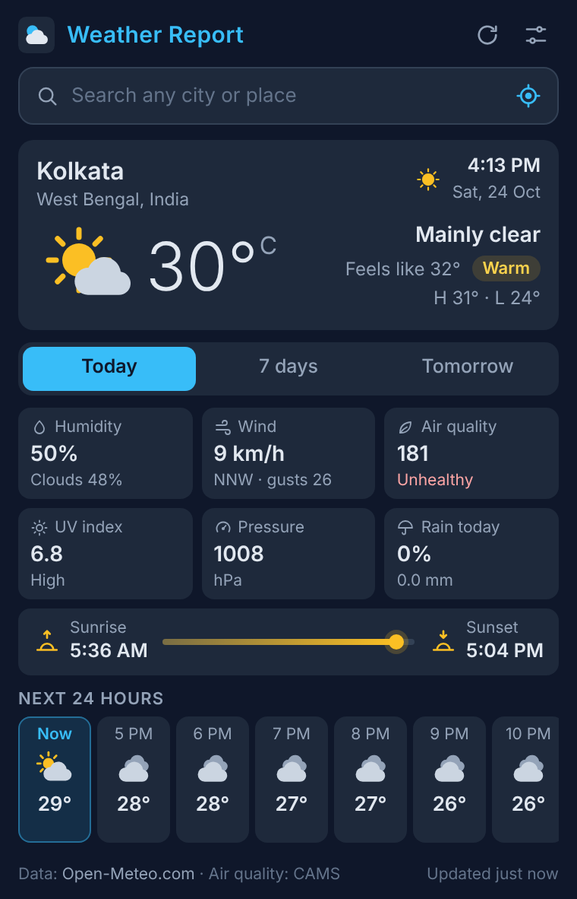
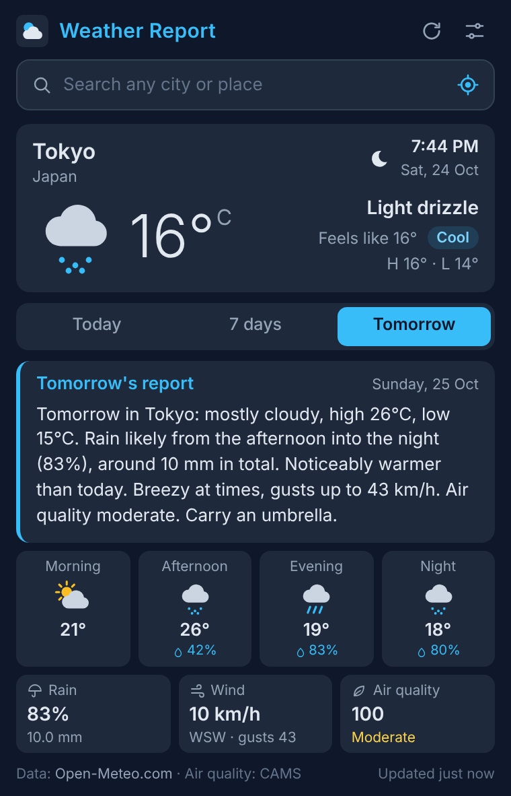
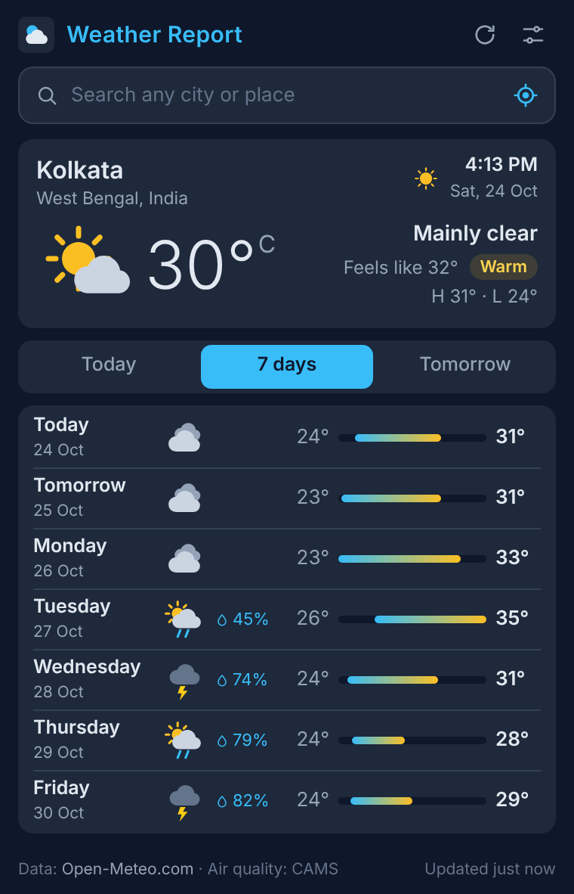

# Weather Report

A small browser extension for Chrome and Firefox that shows the weather for any place in the world:
current conditions, air quality, an hourly and 7-day forecast, and a short
plain-language report for tomorrow.

It uses the free [Open-Meteo](https://open-meteo.com/) APIs, so there is no
account to create and no API key to paste in.

<p>
  
  
  
</p>

## Features

- **Any city or place.** Search as you type, with recent places remembered.
  There's also a "Use my location" button.
- **Current conditions.** Temperature, feels-like, humidity, wind with direction
  and gusts, pressure, UV index and today's rain chance.
- **Hot or cold at a glance.** A small label based on the feels-like
  temperature: Freezing, Cold, Cool, Pleasant, Warm, Hot or Very hot.
- **Air quality (AQI).** US AQI with a colour-coded category such as Good,
  Moderate or Unhealthy.
- **Day and night.** A sun or moon icon based on the place's own local time and
  its sunrise and sunset. New York shows night while it's afternoon in Kolkata.
- **Sunrise and sunset**, with a bar showing how far through the day it is.
- **Next 24 hours** as a scrollable hourly strip, plus a **7-day forecast** with
  highs, lows and rain chance.
- **Tomorrow's report.** A few sentences like a weather bulletin, for example:
  > Tomorrow in Tokyo: mostly cloudy, high 26°C, low 15°C. Rain likely from the
  > afternoon into the night (83%), around 10 mm in total. Breezy at times, gusts
  > up to 43 km/h. Air quality moderate. Carry an umbrella.

  The text is built with simple rules from the forecast numbers in
  [`js/report.js`](js/report.js). It doesn't use any text service.
- **Opens instantly.** The last forecast is cached and shown straight away, then
  refreshed in the background when it's more than 10 minutes old.
- **Works offline.** The saved forecast stays on screen, with a note saying how
  old it is.
- **Settings:** °C or °F, km/h, mph or m/s, and a 12- or 24-hour clock.

## Install

### Firefox: install from Firefox Add-ons

[](https://addons.mozilla.org/en-US/firefox/addon/weather-report-rajat/)

Weather Report is published on [Firefox Add-ons](https://addons.mozilla.org/en-US/firefox/addon/weather-report-rajat/). Open the page in
Firefox and click **Add to Firefox**. Firefox 140 or newer is needed.

### Manual install

Download the latest zip from the
[Releases page](https://github.com/rajatsubharam/weather-report/releases/latest).

### Chrome, Brave or Edge

1. Download `weather-report-chrome-v3.0.1.zip` and unzip it.
2. Open `chrome://extensions` (in Edge: `edge://extensions`).
3. Turn on **Developer mode**.
4. Click **Load unpacked** and select the unzipped folder (the one with
   `manifest.json` in it).
5. Pin **Weather Report** from the puzzle-piece menu, then click it and search
   for a city.

You can also clone the repository and load the `weather-report` folder the
same way:

```
git clone https://github.com/rajatsubharam/weather-report.git
```

### Firefox

- **From Firefox Add-ons:** [install it here](https://addons.mozilla.org/en-US/firefox/addon/weather-report-rajat/) (see above).
- **Try it now:** download `weather-report-firefox-v3.0.1.zip`, open
  `about:debugging#/runtime/this-firefox`, click **Load Temporary Add-on...**
  and pick the zip (or `manifest.json` inside the unzipped folder). A temporary
  add-on stays until Firefox is closed.

Firefox 140 or newer is needed.

## Publishing to Firefox Add-ons

Publishing on [addons.mozilla.org](https://addons.mozilla.org/) is free.

1. Go to the [Add-on Developer Hub](https://addons.mozilla.org/developers/)
   and sign in with a free Firefox account.
2. Click **Submit a New Add-on** and choose **On this site**.
3. Upload `weather-report-firefox-v3.0.1.zip` and wait for the automatic
   validation.
4. When asked whether the add-on uses minified, concatenated or
   machine-generated code, answer **No**. The code is plain JavaScript with no
   build step, so no separate source upload is needed.
5. Fill in the listing (name, summary, description, category, screenshots)
   from [`store/store-listing.md`](store/store-listing.md) and the images in
   `store/`.
6. Add the privacy policy:
   [`store/privacy-policy.md`](store/privacy-policy.md) on GitHub.
7. Submit. You'll get an email once the review is done.

The Firefox add-on ID is set in `manifest.json` under
`browser_specific_settings`. Chrome ignores that key. To check the package
before uploading, run `npx web-ext lint`.

## Publishing to the Chrome Web Store

1. **Create a developer account** at the
   [Chrome Web Store Developer Dashboard](https://chrome.google.com/webstore/devconsole).
   There is a one-time registration fee (US$5), and 2-step verification must be
   turned on for the Google account.
2. **Make the upload zip.** It should hold only the extension files
   (`manifest.json`, `popup.html`, `popup.css`, `js/`, `icons/`). The
   `manifest.json` must be at the root of the zip, not inside a folder:
   ```
   zip -r weather-report-extension.zip manifest.json popup.html popup.css js icons
   ```
3. In the dashboard, click **New item** and upload the zip.
4. **Store listing tab:** copy the descriptions from
   [`store/store-listing.md`](store/store-listing.md). Add the icon, the
   screenshots from `store/` (1280x800) and the small promo tile (440x280).
   Category: *Productivity* (or *Lifestyle*).
5. **Privacy tab:** paste the single-purpose statement and the permission
   reasons from `store/store-listing.md`. Fill in the data-usage form. For the
   privacy policy URL, use the link to
   [`store/privacy-policy.md`](store/privacy-policy.md) on GitHub.
6. **Distribution tab:** choose *Public* and the regions.
7. Click **Submit for review**. Reviews usually take from a few days to about a
   week. You'll get an email when it's published.

For a later update, raise `"version"` in `manifest.json`, make a new zip and
upload it to the same item.

## How it works

| File | What it does |
| --- | --- |
| `manifest.json` | Manifest V3: popup, icons, permissions |
| `popup.html` / `popup.css` | Popup layout and styles (navy `#0f172a`, slate `#1e293b`, sky `#38bdf8`) |
| `js/popup.js` | Start-up, search box, location button, tabs, settings, caching |
| `js/api.js` | Requests to Open-Meteo forecast, geocoding and air quality, with timeouts and error handling |
| `js/ui.js` | Draws the current weather, Today, 7 days and Tomorrow views |
| `js/report.js` | Rules that turn tomorrow's numbers into the short report |
| `js/format.js` | Unit conversion, times and dates, feels-like and AQI labels |
| `js/icons.js` | Hand-drawn flat SVG weather and interface icons |
| `tests/` | Unit tests for the report and formatting (`npm test`, Node 18+) |

APIs used, all keyless:

- Forecast: `https://api.open-meteo.com/v1/forecast`
- Place search: `https://geocoding-api.open-meteo.com/v1/search`
- Air quality: `https://air-quality-api.open-meteo.com/v1/air-quality`

Weather is always requested in metric units and converted when it's shown, so
changing units doesn't need another request.

### Permissions

- `storage` saves your place, settings, recent searches and the last forecast.
- `geolocation` is only used when you click **Use my location**. The
  coordinates are rounded to about 1 km and sent to Open-Meteo to get the
  forecast. If you remove this permission from `manifest.json`, the location
  button hides itself and the rest of the extension still works.

No host permissions are needed, because Open-Meteo allows requests from
browsers (CORS). There is no background script, no remote code and no
analytics.

## Tech stack

HTML, CSS and JavaScript (ES modules, no frameworks or build step), Chrome
Extension Manifest V3, the Open-Meteo APIs, and Node's built-in test runner for
the tests.

## Credits

- Weather data by [Open-Meteo.com](https://open-meteo.com/), licensed under
  [CC BY 4.0](https://creativecommons.org/licenses/by/4.0/).
- Air quality data from the Copernicus Atmosphere Monitoring Service (CAMS),
  via Open-Meteo.
- Place search by Open-Meteo Geocoding, based on [GeoNames](https://www.geonames.org/).
- Icons drawn for this project (see `js/icons.js`).

Open-Meteo's free API is for **non-commercial use** (fewer than 10,000 calls a
day). That fits a free extension with no ads or subscriptions. A paid or
ad-supported version would need an
[Open-Meteo API plan](https://open-meteo.com/en/pricing).

## License

[MIT](LICENSE) © 2026 Rajat Subhara Mondal
